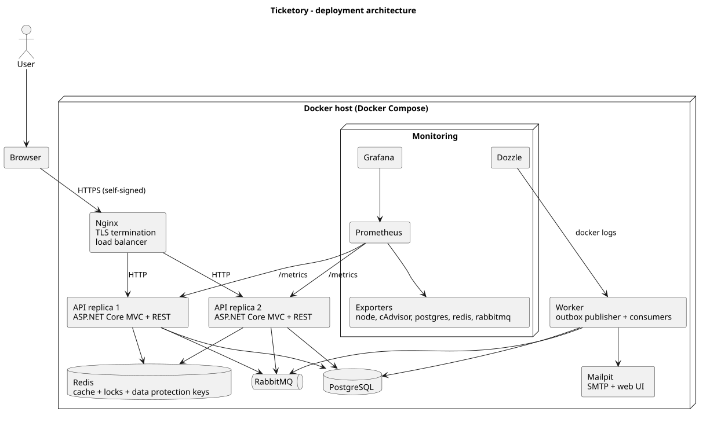

# Ticketory

Ticketory is a containerised event-ticketing platform. It demonstrates a complete, production-shaped ASP.NET Core solution with PostgreSQL, Redis, RabbitMQ, Nginx, HTTPS, monitoring, automated tests and a documented architecture.

## Start here

There are two supported ways to run Ticketory. Use **Local Docker** for the full assignment demo; use **GitHub Codespaces** when Docker is not available locally.

| Track | Best for | Open |
|---|---|---|
| Local Docker | Full HTTPS demo: Nginx, two API replicas, Redis, RabbitMQ, monitoring | <https://localhost> |
| GitHub Codespaces | Browser-only environment; no local Docker | forwarded port `8080` |

> **Reviewer note:** for the assignment review, use the Local Docker track. It demonstrates the complete stack, including HTTPS and load balancing.

**Local Docker**

Prerequisites: Docker Desktop with Compose v2, Git and `openssl`. On Windows, run the `.sh` scripts from Git Bash or WSL. .NET 10 SDK is only needed for `dotnet test`.

```bash
git clone <repo-url>
cd ticketory
cp .env.example .env
./scripts/gen-certs.sh
docker compose up -d --build
```

Open <https://localhost> and accept the self-signed certificate warning. Demo accounts: see [Demo accounts](#demo-accounts).

Subsequent starts: `docker compose up -d`.  
Stop: `docker compose down`.  
Reset database: `docker compose down -v`, then `docker compose up -d --build`.

**GitHub Codespaces**

1. Make sure the repository contains `.devcontainer/`, `docker-compose.codespaces.yml`, `nginx/nginx.codespaces.conf` and `scripts/codespaces-start.sh`.
2. Open **Code → Codespaces → Create codespace on main** (4-core / 16 GB recommended).
3. Wait for the devcontainer build, then run:

```bash
./scripts/codespaces-start.sh
```

4. Open the forwarded port `8080` (Ticketory UI). Other ports: `3000` Grafana, `9090` Prometheus, `15672` RabbitMQ, `8025` Mailpit, `8888` Dozzle.

Do **not** run the local `docker compose up -d --build` commands in Codespaces. The Codespaces script starts `nginx-codespaces` over HTTP `8080`, creates `.env` if needed and excludes `cAdvisor`.

If the Codespace was created before `.devcontainer` was pushed, rebuild the container or create a new Codespace. If a forwarded URL shows 502, wait for the API replicas to become healthy; details in [GitHub Codespaces](#github-codespaces).

Details: [Local Docker quick start](#local-docker-quick-start) · [GitHub Codespaces](#github-codespaces).

## Highlights

- **ASP.NET Core 10 MVC UI + REST API** with ASP.NET Core Identity and JWT.
- **Two API replicas** behind **Nginx** (TLS termination, load balancing, rate limiting).
- **PostgreSQL** as the source of truth, **Redis** for cache, distributed locks and Data Protection keys.
- **RabbitMQ** with an outbox publisher, retry queues, dead-letter queue and idempotent consumers.
- **Mailpit** captures the ticket e-mails so the asynchronous flow can be demonstrated end-to-end.
- **Cancellation and refund flow**: pending orders are cancelled, paid orders are refunded, and separate customer e-mails are sent.
- **Ticket e-mails include inline QR codes** (CID images) as well as the ticket code.
- **Event reopen**: a cancelled future event can be reopened as a draft and published again.
- **Admin outbox audit page** shows every message published by the app (type, payload, processed/retry state).
- **Prometheus + Grafana + exporters + Dozzle** for metrics, dashboards, alerts and logs.
- **Self-signed HTTPS** certificate for `localhost`.
- **37 automated tests** (domain unit tests + API integration tests with Testcontainers PostgreSQL and `FakeTimeProvider`).
- **UML class diagram**, architecture diagram and presentation.

## Architecture



The class diagram is available at [`docs/class-diagram.svg`](docs/class-diagram.svg).

### Request and event flow

1. The browser calls `https://localhost`. Nginx terminates TLS and forwards the request to one of the API replicas (`least_conn`).
2. The API uses PostgreSQL for persistent data and Redis for cache/locks.
3. Creating an order:
   - the API acquires a Redis lock per ticket type,
   - reserves stock inside a PostgreSQL transaction,
   - writes an `OrderCreated` message to the **outbox** table.
4. The Worker publishes the outbox message to RabbitMQ and consumes it:
   - `OrderCreated` → simulated payment → `PaymentSucceeded`,
   - `PaymentSucceeded` → ticket and QR issuance → `TicketsIssued`,
   - `TicketsIssued` → e-mail through Mailpit.
5. Failed messages are retried through a TTL retry queue and then moved to a dead-letter queue.
6. Cancelling an event:
   - pending orders are cancelled and their stock is released;
   - paid orders are refunded, their payments marked as refunded and their tickets cancelled;
   - `order.cancelled` / `order.refunded` messages trigger the corresponding customer e-mails.
7. A cancelled future event can be reopened as a draft and published again.

## Technology choices (and why)

| Technology | Why it is used |
|---|---|
| ASP.NET Core MVC + Identity | Server-rendered CRUD UI, roles (Admin / Organizer / Customer) and secure cookie authentication. |
| ASP.NET Core REST API + JWT | Machine-friendly API for the same domain, documented with Swagger/OpenAPI. |
| PostgreSQL | Transactions, unique constraints, referential integrity and reliable storage of orders and stock. |
| Redis | Cache-aside for event listings/details, distributed lock against overselling, shared Data Protection keys between replicas. |
| RabbitMQ | Asynchronous payment, ticket issuance and notification; retry and dead-letter handling. |
| Nginx | Single HTTPS entry point, load balancing over two replicas, rate limiting, security headers. |
| Docker Compose | Reproducible one-command startup of the entire stack. |
| Prometheus + Grafana | Metrics, dashboards and alert rules for the API, PostgreSQL, Redis, RabbitMQ and containers. |
| Dozzle | Browser-based container log viewer for the demo. |
| xUnit + FluentAssertions + WebApplicationFactory + Testcontainers | Domain unit tests and API integration tests against a real PostgreSQL container. |
| TimeProvider + FakeTimeProvider | Deterministic time handling in services/worker and controllable time in tests. |

## Local Docker quick start

### Prerequisites

- Docker Desktop (Docker Compose v2); it must be running for `dotnet test` as well, because Testcontainers starts PostgreSQL.
- Git.
- `openssl` (already available on macOS/Linux). On Windows, run the `.sh` scripts from Git Bash or WSL.
- .NET 10 SDK (only for `dotnet test`; the Docker build uses the SDK image).

### 1. Configure secrets

The repository does **not** commit `.env`; only `.env.example` is tracked. On a fresh clone, create it:

```bash
cp .env.example .env
```

The example values are valid for the demo. If you already have a local `.env`, keep it — it is **git-ignored** and must never be committed.

### 2. Generate the self-signed certificate

```bash
./scripts/gen-certs.sh
```

This creates `nginx/certs/server.crt` and `nginx/certs/server.key` with SAN entries for `localhost`, `ticketory.local` and `127.0.0.1`.

### 3. Start the stack

```bash
docker compose up -d --build
```

The first build pulls the .NET SDK/runtime images and can take a few minutes.

### 4. Open the application

| URL | Purpose |
|---|---|
| <https://localhost> | Ticketory UI (accept the self-signed certificate warning) |
| <https://localhost/swagger> | REST API documentation |
| <https://localhost/health/ready> | Readiness health check |
| <https://localhost/health/live> | Liveness health check |
| <https://localhost/metrics> | Prometheus metrics |
| <http://localhost:3000> | Grafana (`admin` / password from `.env`) |
| <http://localhost:9090> | Prometheus |
| <http://localhost:15672> | RabbitMQ management (`ticketory` / password from `.env`) |
| <http://localhost:8025> | Mailpit (captured e-mails) |
| <http://localhost:8888> | Dozzle (container logs) |

### Demo accounts

The database is seeded on first start. E-mail addresses are configured in `appsettings.json`:

- `admin@ticketory.local` — Admin
- `organizer@ticketory.local` — Organizer
- `customer@ticketory.local` — Customer

Passwords are in `.env` only (`SEED_*_PASSWORD`). On a fresh clone created from `.env.example`, the seeded passwords are:

- `admin@ticketory.local` / `ChangeMe_Admin_123`
- `organizer@ticketory.local` / `ChangeMe_Organizer_123`
- `customer@ticketory.local` / `ChangeMe_Customer_123`

If `.env` is missing, the seed passwords are empty and the users are skipped. In Production, a missing `JWT_SECRET` also prevents the API from starting. If the PostgreSQL volume already exists, users are not recreated and passwords are not updated; to reset the database use:

```bash
docker compose down -v
docker compose up -d --build
```

You can also register a new customer from the UI.

## GitHub Codespaces

The repository includes a `.devcontainer` with Docker-in-Docker and .NET 10, plus a Codespaces-specific Compose override.

1. The repository must contain `.devcontainer/`, `docker-compose.codespaces.yml`, `nginx/nginx.codespaces.conf` and `scripts/codespaces-start.sh`; `.env` is not committed.
2. Open the repository in GitHub Codespaces (**Code → Codespaces → Create codespace on main**). A 4-core / 16 GB machine is recommended; 2-core / 8 GB may be too slow or run out of memory.
3. Wait for the devcontainer build (Docker-in-Docker + .NET 10).
4. Start the stack:
   ```bash
   ./scripts/codespaces-start.sh
   ```
5. Open the forwarded ports:

   | Port | Service |
   |---|---|
   | 8080 | Ticketory UI |
   | 3000 | Grafana |
   | 9090 | Prometheus |
   | 15672 | RabbitMQ Management |
   | 8025 | Mailpit |
   | 8888 | Dozzle |

6. Log in with the seeded users. If `.env` was created from `.env.example`, the passwords are `ChangeMe_*_123`.
7. If a forwarded URL shows 502, wait for the API replicas to become healthy and check:
   ```bash
   docker compose -f docker-compose.yml -f docker-compose.codespaces.yml ps
   docker compose -f docker-compose.yml -f docker-compose.codespaces.yml logs nginx-codespaces
   ```
8. Reset the database:
   ```bash
   docker compose -f docker-compose.yml -f docker-compose.codespaces.yml down -v
   ./scripts/codespaces-start.sh
   ```
9. Run the tests (the devcontainer includes .NET 10 and Docker):
   ```bash
   dotnet test Ticketory.slnx
   ```

### Failover demo in Codespaces

The Codespaces Nginx uses `least_conn` over `api-1` and `api-2` with passive health checks. Start both replicas first, then stop one:

```bash
docker compose -f docker-compose.yml -f docker-compose.codespaces.yml ps
docker compose -f docker-compose.yml -f docker-compose.codespaces.yml stop api-2

for i in $(seq 1 10); do
  curl -sS -D - -o /dev/null http://localhost:8080/ | grep -i '^x-served-by'
done
```

The first requests may be retried. After `max_fails=3` / `fail_timeout=10s`, Nginx marks `api-2` down and all traffic goes to `api-1`. The UI stays available and the header shows `x-served-by: api-1`.

Restore the replica and reload Nginx so it re-resolves the container IP:

```bash
docker compose -f docker-compose.yml -f docker-compose.codespaces.yml start api-2
docker compose -f docker-compose.yml -f docker-compose.codespaces.yml exec nginx-codespaces nginx -s reload
```

To show the other replica:

```bash
docker compose -f docker-compose.yml -f docker-compose.codespaces.yml stop api-1
# curl loop -> x-served-by: api-2
docker compose -f docker-compose.yml -f docker-compose.codespaces.yml start api-1
docker compose -f docker-compose.yml -f docker-compose.codespaces.yml exec nginx-codespaces nginx -s reload
```

**Notes:**
- Start both replicas before the demo; `api-1` runs migrations/seed, `api-2` has `Database__InitializeOnStartup=false`.
- Do not stop both replicas or `nginx-codespaces`.
- Use GET/browser requests for the failover demo. Nginx does not retry non-idempotent POST requests by default; wait a few seconds after stopping a replica before logging in or creating an order.
- Sessions remain valid across replicas because Data Protection keys are stored in Redis.
- `X-Served-By` is visible in the terminal via `curl` or in browser DevTools → Network → Response Headers.
- Codespaces is a fallback; local Docker is the primary demo and does not depend on Codespaces availability.

Notes:

- Codespaces provides HTTPS through its port proxy. The Codespaces Nginx listens on HTTP `8080` and sets `X-Forwarded-Proto: https`; the self-signed certificate is used only in the local Docker setup.
- `cAdvisor` is excluded from the Codespaces start script because it needs privileged access. The per-container CPU/memory panels may be empty, while Prometheus, Grafana, the exporters and Dozzle work.
- `.env` is created automatically by the devcontainer/start script if it is missing.
- Do **not** run the local `docker compose up -d --build` commands in Codespaces; use `./scripts/codespaces-start.sh`.
- If the Codespace was created before `.devcontainer` was pushed, rebuild the container or create a new Codespace.
- If a 4-core machine is not available, use the local Docker track.

## Configuration

Configuration is layered:

1. `appsettings.json` — non-secret defaults for local development.
2. `appsettings.{Environment}.json` — environment overrides. Docker uses `appsettings.Production.json` for container hostnames (`postgres`, `redis`, `rabbitmq`, `mailpit`).
3. Environment variables — secrets only in Docker: `Database__Password`, `Redis__Password`, `RabbitMq__Password`, `Jwt__Secret`, `Seed__*Password`.
4. `dotnet user-secrets` — local secrets for `dotnet run` (Api and Worker share the `ticketory-local` secret store).

No production secrets are stored in `appsettings*.json` or source code; demo/test credentials are placeholders. The main settings live in:

- `ConnectionStrings:Default` / `ConnectionStrings:Redis` — non-secret connection strings.
- `Database:Password`, `Redis:Password`, `RabbitMq:Password` — injected from secrets.
- `Caching:*`, `Locks:*`, `Outbox:*` — TTLs, lock timings, outbox batch/poll/retry settings.
- `RabbitMq:*` — host, credentials (password from secrets), topology, prefetch and retry policy.
- `Jwt:*` — issuer, audience, expiry and clock skew (secret from secrets).
- `Seed:*` — demo e-mail addresses and `DemoData`.
- `Instance:Id` — value returned in `X-Served-By`.

For local development:

```bash
dotnet user-secrets --project src/Ticketory.Api set "Database:Password" "..."
dotnet user-secrets --project src/Ticketory.Api set "Redis:Password" "..."
dotnet user-secrets --project src/Ticketory.Api set "RabbitMq:Password" "..."
dotnet user-secrets --project src/Ticketory.Api set "Jwt:Secret" "..."
```

## Project structure

```text
ticketory/
├── src/
│   ├── Ticketory.Domain/          # entities, enums, domain rules
│   ├── Ticketory.Application/     # DTOs, abstractions, use-case services
│   ├── Ticketory.Infrastructure/  # EF Core, Identity, Redis, RabbitMQ, SMTP, QR
│   ├── Ticketory.Api/             # MVC UI + REST API + health + metrics
│   ├── Ticketory.Worker/          # outbox publisher + RabbitMQ consumers
│   └── Ticketory.Tests/           # xUnit + WebApplicationFactory tests
├── nginx/                          # nginx.conf and generated certificates
├── monitoring/                     # Prometheus, Grafana provisioning and dashboards
├── rabbitmq/                       # enabled_plugins
├── scripts/                        # certificate generation and Codespaces startup
├── docs/                           # UML, architecture, presentation, mapping
├── docker-compose.yml
├── .env.example
└── README.md
```

## REST API

| Method | Endpoint | Auth | Description |
|---|---|---|---|
| POST | `/api/auth/register` | anonymous | Register a customer and receive a JWT. |
| POST | `/api/auth/login` | anonymous | Log in and receive a JWT. |
| GET | `/api/events?search=&page=&pageSize=` | anonymous | Paged, cached published events. |
| GET | `/api/events/{id}` | anonymous | Event details with ticket types and reviews. |
| POST | `/api/events` | Organizer/Admin (JWT) | Create an event. |
| PUT | `/api/events/{id}` | Organizer/Admin (JWT) | Update an event. |
| DELETE | `/api/events/{id}` | Organizer/Admin (JWT) | Delete an event. |
| POST | `/api/events/{id}/publish` | Organizer/Admin (JWT) | Publish an event. |
| POST | `/api/events/{id}/cancel` | Organizer/Admin (JWT) | Cancel an event. |
| POST | `/api/events/{id}/reopen` | Organizer/Admin (JWT) | Reopen a cancelled future event as a draft. |
| GET | `/api/events/{eventId}/reviews` | anonymous | Reviews for an event. |
| POST | `/api/events/{eventId}/reviews` | Customer (JWT) | Add a review (requires a paid ticket). |
| POST | `/api/orders` | Customer (JWT) | Create an order. Supports `Idempotency-Key` header. |
| GET | `/api/orders` | Customer (JWT) | Current user's orders. |
| GET | `/api/orders/{id}` | Owner/Admin (JWT) | Order details. |
| POST | `/api/orders/{id}/cancel` | Owner/Admin (JWT) | Cancel a pending order. |
| GET | `/api/orders/all` | Admin (JWT) | Latest orders (admin view). |
| GET | `/api/tickets` | Customer (JWT) | Current user's tickets. |
| GET | `/api/tickets/{code}` | Owner/Admin (JWT) | Ticket by code. |
| GET | `/api/tickets/{code}/qr` | Owner/Admin (JWT) | QR code as SVG. |
| GET | `/api/dashboard` | Admin (JWT) | Dashboard statistics. |

Example order creation:

```bash
TOKEN="<JWT from /api/auth/login>"
curl -k -X POST https://localhost/api/orders \
  -H "Authorization: Bearer $TOKEN" \
  -H "Content-Type: application/json" \
  -H "Idempotency-Key: demo-order-1" \
  -d '{"items":[{"ticketTypeId":"<ticket-type-id>","quantity":2}]}'
```

## Monitoring

- **Prometheus** scrapes both API replicas, PostgreSQL, Redis, RabbitMQ, node-exporter and cAdvisor.
- **Grafana** is provisioned with a `Ticketory overview` dashboard: request rate, p95 latency, 5xx rate, queue backlog, API instances up, Redis cache hit ratio, PostgreSQL connections and container CPU/memory.
- **Alert rules** in `monitoring/prometheus/alerts.yml`: API instance down, high 5xx rate, RabbitMQ backlog, exporter down.
- **Dozzle** provides live container logs.
- The API exposes `/health/live` and `/health/ready` (PostgreSQL, Redis and RabbitMQ checks).
- Per-container CPU/memory panels use cAdvisor. On Docker Desktop cAdvisor exposes `id="/docker/<hash>"` instead of container names, so the legend shows a short container ID. Docker build-cache containers (`buildkit`/`buildx`) are excluded from these panels.

## HTTPS with a self-signed certificate

TLS is terminated at Nginx. The certificate is generated by `scripts/gen-certs.sh` and contains a Subject Alternative Name (SAN) for `localhost`, `ticketory.local` and `127.0.0.1`.

Because the certificate is signed by its own key instead of a public CA, the browser shows a warning (`NET::ERR_CERT_AUTHORITY_INVALID`). This is expected. For the demo:

- accept the warning with **Advanced → Proceed**, or
- trust the certificate locally (macOS):

```bash
sudo security add-trusted-cert -d -r trustRoot \
  -k /Library/Keychains/System.keychain nginx/certs/server.crt
```

For a real deployment, replace the certificate with one issued by Let's Encrypt or an internal CA. The private key is git-ignored and never baked into the images.

## OS-level cluster and Keepalived

Keepalived and Corosync/Pacemaker were intentionally **not** implemented in this Docker-based solution:

- They operate at the Linux host level (systemd, VRRP/multicast, fencing/STONITH), not inside Docker containers.
- A meaningful demonstration needs at least two Linux VMs and a floating VIP; running VRRP inside Docker Desktop on macOS is unreliable.
- The required high-availability behaviour is already covered by two API replicas behind Nginx, health checks and automatic container restart.

The rationale and a possible VM-based extension are documented in [`docs/https-and-ha.md`](docs/https-and-ha.md).

## Tests

```bash
dotnet test Ticketory.slnx
```

The test suite contains:

- domain unit tests for stock reservation, order state transitions, event publishing/reopen, refunds and reviews,
- time-dependent tests using `FakeTimeProvider` (event visibility and order creation after the event start),
- API integration tests for cancellation/refund/reopen, using `WebApplicationFactory`, Testcontainers PostgreSQL (real migrations), JWT, a no-op distributed lock and an in-memory cache,
- a QR PNG generation test.

Docker must be running: Testcontainers starts a `postgres:16-alpine` container for the test run.

## Documentation and deliverables

- [`docs/class-diagram.svg`](docs/class-diagram.svg) — UML class diagram with attributes, methods, relationships and multiplicities.
- [`docs/architecture.svg`](docs/architecture.svg) — deployment architecture.
- [`docs/architecture.md`](docs/architecture.md) — component descriptions, configuration and startup.
- [`docs/requirements-mapping.md`](docs/requirements-mapping.md) — mapping of every assignment requirement to the implementation.
- [`docs/https-and-ha.md`](docs/https-and-ha.md) — HTTPS and OS-level HA explanation.
- [`docs/presentation.md`](docs/presentation.md) — Marp presentation source (10 slides).
- [`docs/presentation.html`](docs/presentation.html) — standalone HTML slide deck (loads the two SVG diagrams from `docs/`).
- [`docs/presentation.pdf`](docs/presentation.pdf) — PDF export.

> `presentation.md` is Marp Markdown. A plain Markdown preview will render the Marp YAML front matter as text; use `presentation.html` or `presentation.pdf` (or a Marp-aware preview) to view the slides.

## Security notes

- No production secrets are stored in source code or `appsettings*.json`; secrets come from `.env` (Docker) or `dotnet user-secrets` (local). Demo/test credentials are placeholders.
- `.env`, certificate private keys and generated keys are git-ignored.
- The API and Worker containers run as a non-root user.
- Nginx adds HSTS, `X-Content-Type-Options`, `X-Frame-Options`, `Referrer-Policy` and rate limiting.
- API authorization uses JWT; the MVC UI uses ASP.NET Core Identity cookies.
- Redis stores Data Protection keys so cookies and antiforgery tokens work across both replicas.

## Troubleshooting

- **Certificate warning** — expected with a self-signed certificate; see the HTTPS section.
- **Nginx does not start** — check that `nginx/certs/server.crt` and `server.key` exist (`./scripts/gen-certs.sh`) and that both API replicas are healthy.
- **Port already in use** — stop the conflicting service or change the published ports in `docker-compose.yml`.
- **Build fails or is killed** — stop the stack with `docker compose down` to free memory, increase Docker Desktop memory if needed, then run `docker compose up -d --build` again.
- **Codespaces: Docker is not available** — rebuild the devcontainer and make sure `.devcontainer` is committed; then run `./scripts/codespaces-start.sh`.
- **Codespaces: wrong start command** — use `./scripts/codespaces-start.sh`, not the local `docker compose up` commands.
- **RabbitMQ credentials changed** — the RabbitMQ user is created only on first boot; remove the `rabbitmq-data` volume and recreate the container.
- **Clean restart** — `docker compose down -v` removes containers and volumes (all data is lost).
