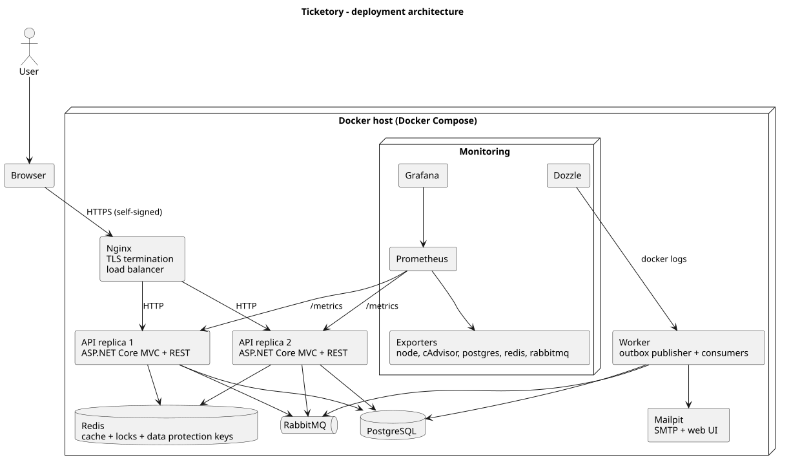
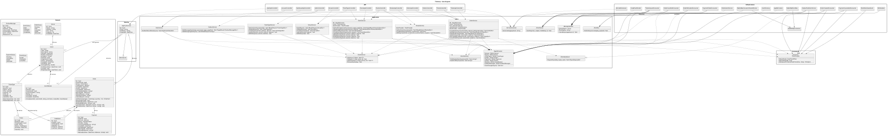

# Ticketory — architecture and configuration

## 1. Overview

Ticketory is an event-ticketing application with a server-rendered UI and a REST API. The whole stack runs with Docker Compose.



The application follows a pragmatic layered structure:

- **Domain** — entities and business rules, no infrastructure dependencies.
- **Application** — DTOs, abstractions and use-case services.
- **Infrastructure** — EF Core, ASP.NET Core Identity, Redis, RabbitMQ, SMTP and QR generation.
- **API** — MVC UI, REST API, health checks and metrics.
- **Worker** — outbox publisher and RabbitMQ consumers.

## 2. Components

| Component | Responsibility | Configuration |
|---|---|---|
| `nginx` | TLS termination, HTTP→HTTPS redirect, load balancing, rate limiting, security headers. | `nginx/nginx.conf`, `nginx/certs/` |
| `api-1`, `api-2` | ASP.NET Core MVC UI + REST API. Two replicas behind Nginx. | `appsettings*.json`, `Database__Password`, `Redis__Password`, `RabbitMq__Password`, `Jwt__Secret`, `Seed__*Password`, `Instance__Id` |
| `worker` | Publishes outbox messages, consumes RabbitMQ messages, issues tickets and sends e-mail. | `appsettings*.json`, `Database__Password`, `Redis__Password`, `RabbitMq__Password` |
| `postgres` | Primary data store (events, orders, tickets, Identity). | `POSTGRES_DB`/`POSTGRES_USER` (Compose), `POSTGRES_PASSWORD` (`.env`) |
| `redis` | Cache, distributed locks and Data Protection key storage. | `REDIS_PASSWORD` (`.env`) |
| `rabbitmq` | Topic exchange `ticketory.events`, retry exchange/queues, dead-letter exchange/queue. | `RABBITMQ_DEFAULT_USER` (Compose), `RABBITMQ_DEFAULT_PASS` (`.env`), `rabbitmq/enabled_plugins` |
| `mailpit` | SMTP sink and web UI for the ticket e-mails. | ports 1025/8025 |
| `prometheus` | Scrapes API and infrastructure metrics. | `monitoring/prometheus/` |
| `grafana` | Provisioned datasource and `Ticketory overview` dashboard. | `monitoring/grafana/` |
| `node-exporter`, `cadvisor` | Host and container metrics. | — |
| `postgres-exporter`, `redis-exporter`, RabbitMQ Prometheus plugin | Database/cache/broker metrics. | — |
| `dozzle` | Container log viewer. | Docker socket |

## 3. Networks

- **edge** — Nginx and the API replicas.
- **internal** — API, Worker, PostgreSQL, Redis, RabbitMQ, Mailpit, exporters.
- **monitoring** — Prometheus, Grafana, exporters, cAdvisor, node-exporter, Dozzle.

Nginx cannot reach PostgreSQL or Redis directly; only the application services can.

## 4. Configuration

Configuration is layered:

1. `appsettings.json` — non-secret defaults for local development.
2. `appsettings.{Environment}.json` — environment overrides. Docker uses `appsettings.Production.json` for container hostnames.
3. Environment variables — secrets only in Docker.
4. `dotnet user-secrets` — local development secrets (Api and Worker share the `ticketory-local` store).

| Setting | Location | Meaning |
|---|---|---|
| `ConnectionStrings:Default` | `appsettings*.json` | PostgreSQL connection string without password. |
| `ConnectionStrings:Redis` | `appsettings*.json` | Redis endpoint without password. |
| `Database:Password` | `.env` / user-secrets (`Database__Password`) | PostgreSQL password. |
| `Redis:Password` | `.env` / user-secrets (`Redis__Password`) | Redis password. |
| `Database:InitializeOnStartup` | `appsettings*.json` / Compose (`Database__InitializeOnStartup`) | Run migrations and seed on startup. |
| `Redis:InstanceName`, `Redis:AbortOnConnectFail`, `Redis:DataProtectionKeyName` | `appsettings*.json` | Redis behaviour and Data Protection key name. |
| `RabbitMq:Host`, `Port`, `VirtualHost`, `Username`, `Exchange`, `PrefetchCount`, `MaxRetries`, ... | `appsettings*.json` | Broker endpoint, topology and retry policy. |
| `RabbitMq:Password` | `.env` / user-secrets (`RabbitMq__Password`) | Broker password. |
| `Caching:*`, `Locks:*`, `Outbox:*` | `appsettings*.json` | TTLs, lock timings, outbox batch/poll/retry. |
| `Jwt:Issuer`, `Audience`, `ExpiryMinutes`, `ClockSkewSeconds` | `appsettings*.json` | JWT validation and lifetime. |
| `Jwt:Secret` | `.env` / user-secrets (`Jwt__Secret`) | Symmetric signing key. |
| `Seed:*Email`, `Seed:DemoData` | `appsettings*.json` | Demo accounts and whether to seed them. |
| `Seed:*Password` | `.env` / user-secrets (`Seed__*Password`) | Demo account passwords. |
| `Smtp:Host`, `Port`, `From`, `UseStartTls` | `appsettings*.json` | Mailpit SMTP settings. |
| `Instance:Id` | `appsettings*.json` / Compose (`Instance__Id`) | Value returned in `X-Served-By`. |
| `POSTGRES_DB`, `POSTGRES_USER`, `RABBITMQ_DEFAULT_USER`, `GF_SECURITY_ADMIN_USER` | `docker-compose.yml` | Non-secret container identities. |
| `POSTGRES_PASSWORD`, `REDIS_PASSWORD`, `RABBITMQ_PASSWORD`, `GRAFANA_ADMIN_PASSWORD` | `.env` | Container secrets. |

The API and Worker build the PostgreSQL connection string with `NpgsqlConnectionStringBuilder` and inject `Database:Password`; the Redis connection is built with `ConfigurationOptions` and `Redis:Password`; RabbitMQ uses the `RabbitMq` options and `RabbitMq:Password`.

`Instance:Id` is returned in the `X-Served-By` response header, which makes load balancing visible during the demo.

## 5. Startup sequence

1. PostgreSQL, Redis and RabbitMQ start and become healthy.
2. `api-1` starts, applies EF Core migrations and seeds roles, users, venues and demo events.
3. `api-1` becomes healthy; `api-2` starts with `Database:InitializeOnStartup=false`.
4. Nginx starts only after both API replicas are healthy.
5. The Worker connects to RabbitMQ, declares exchanges/queues and starts consuming.
6. Prometheus starts scraping; Grafana loads the provisioned dashboard.

## 6. Domain model



Main invariants:

- `TicketType.Sold` never exceeds `Capacity` (`Reserve` throws a domain exception).
- An `Order` can only be paid while it is not cancelled.
- A paid order cannot be cancelled; a pending order can be cancelled and releases stock.
- A review requires a paid ticket for the event and is unique per customer and event.
- The outbox message is written in the same `SaveChanges` call as the order, avoiding the dual-write problem.

### Time handling

- Domain methods that depend on time accept `DateTime utcNow` (`Event.Publish`, `Order.MarkPaid`, `EventReview.Create`).
- Application and Worker classes inject .NET `TimeProvider` and capture `now` once per operation, so all timestamps in that operation are consistent.
- `TimeProvider.System` is registered in DI; tests replace it with `FakeTimeProvider` and can advance time deterministically.
- This makes rules such as “event is visible only before it starts” and “orders are rejected after the event start” testable without sleeping.
- JWT token generation still uses `DateTime.UtcNow`, because JWT validation uses the framework clock rather than the application `TimeProvider`.

## 7. Asynchronous flow

```text
POST /api/orders
  └─ Redis lock (per ticket type)
     └─ PostgreSQL transaction: reserve stock + Order + OutboxMessage
        └─ Worker: OutboxPublisherService
           └─ RabbitMQ: order.created
              └─ OrderCreatedConsumer: simulated payment
                 └─ OutboxMessage: payment.succeeded
                    └─ PaymentSucceededConsumer: issue tickets
                       └─ OutboxMessage: tickets.issued
                          └─ TicketsIssuedConsumer: e-mail via Mailpit
```

Reliability features:

- **Outbox pattern** — no lost messages if the process crashes between the database commit and the RabbitMQ publish.
- **Idempotency** — `OrderCreated` and `PaymentSucceeded` consumers check the order/payment state before acting; the API supports an `Idempotency-Key` header.
- **Retry queue** — failed messages are republished to a TTL retry queue (5 seconds) up to 3 times.
- **Dead-letter queue** — malformed or repeatedly failing messages go to `ticketory.dead-letter`.

RabbitMQ topology:

| Exchange | Type | Routing key | Queue |
|---|---|---|---|
| `ticketory.events` | topic | `order.created` | `ticketory.order-created` |
| `ticketory.events` | topic | `payment.succeeded` | `ticketory.payment-succeeded` |
| `ticketory.events` | topic | `payment.failed` | `ticketory.payment-failed` |
| `ticketory.events` | topic | `tickets.issued` | `ticketory.tickets-issued` |
| `ticketory.events` | topic | `order.cancelled` | `ticketory.order-cancelled` |
| `ticketory.events` | topic | `order.refunded` | `ticketory.order-refunded` |
| `ticketory.retry` | direct | `retry.<queue>` | `retry.<queue>` (TTL 5s, dead-letters back) |
| `ticketory.dlx` | direct | `dead` | `ticketory.dead-letter` |

### Cancellation, refunds and reopen

Event lifecycle:

```text
Draft ──Publish──► Published ──Cancel──► Cancelled
  ▲                                         │
  └────────────── Reopen ◄──────────────────┘
```

- **Organizer** can cancel only before `StartsAt`.
- **Admin** can cancel at any time before `Completed`.
- `Cancel`:
  - pending orders → `Cancelled`, stock released, `order.cancelled` e-mail;
  - paid orders → `Refunded`, payment `Refunded`, tickets `Cancelled`, stock released, `order.refunded` e-mail;
  - all updates and outbox messages are saved in one transaction.
- `Reopen` is allowed only for a cancelled future event and returns it to `Draft`.
- Old refunded/cancelled orders remain as history; new purchases create new orders.
- The ticket e-mail embeds an inline PNG QR code (CID) for each ticket.

Race-condition guards:

- `OrderCreatedConsumer` skips cancelled/refunded/failed orders.
- `PaymentSucceededConsumer` issues tickets only for paid orders.
- `TicketsIssuedConsumer` sends the e-mail only if the order is still paid.

The Admin → Messages page exposes the outbox history (type, payload, processed/retry state) with filters by message type and processed status.

## 8. Redis usage

| Purpose | Key pattern | Notes |
|---|---|---|
| Published-event list cache | `ticketory:events:{version}:{search}:{page}:{pageSize}` | 30-second TTL; version is bumped on every mutation. |
| Event details cache | `ticketory:event:{id}` | 2-minute TTL; invalidated on event/stock/review changes. |
| Dashboard cache | `ticketory:dashboard:stats` | 15-second TTL. |
| Reservation lock | `lock:ticket-type:{id}` | `SET NX PX` + Lua compare-and-delete. |
| Data Protection keys | `ticketory:data-protection-keys` | Shared by both API replicas so cookies/antiforgery work. |

The cache service degrades gracefully: if Redis is unavailable, reads fall back to the database and writes are skipped.

## 9. Monitoring

- API metrics: `http_requests_received_total`, `http_request_duration_seconds`, `http_requests_in_progress` from `prometheus-net`.
- PostgreSQL: `pg_stat_database_*`.
- Redis: `redis_keyspace_*`, `redis_connected_clients`.
- RabbitMQ: `rabbitmq_queue_messages`, connection/channel metrics.
- Containers: cAdvisor; host: node-exporter.
- Health: `/health/live` (process only) and `/health/ready` (PostgreSQL, Redis, RabbitMQ).

On Docker Desktop, cAdvisor exposes container metrics with an `id` label (`/docker/<hash>`) rather than a `name` label. The Grafana per-container CPU/memory panels therefore group by `id` and show a shortened container ID in the legend. Docker build-cache containers (`buildkit`/`buildx`) are excluded from these panels.

## 10. Failure behaviour

- If one API replica stops, Nginx routes traffic to the surviving replica (`proxy_next_upstream` + passive health checks).
- If PostgreSQL is unavailable, the readiness check fails and the API cannot serve data; the container remains up and reconnects.
- If Redis is unavailable, caching degrades but the API remains usable; reservation locks fail closed (the order is rejected) to protect stock integrity.
- If RabbitMQ is unavailable, the outbox keeps messages in PostgreSQL and the publisher retries; the HTTP request is not blocked.
- If a consumer fails, the message is retried and eventually dead-lettered; other queues continue independently.
