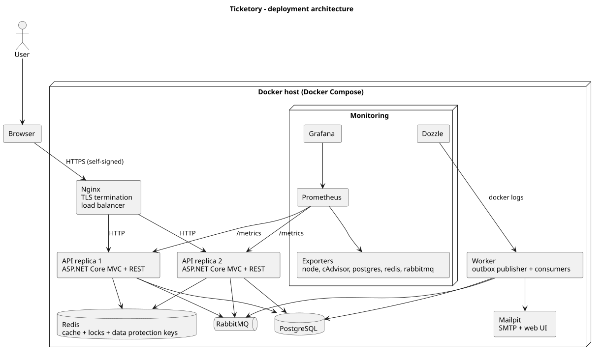

# Ticketory

### Event ticketing with ASP.NET Core, PostgreSQL, Redis, RabbitMQ and Nginx

A containerised, monitored and tested solution with two API replicas and asynchronous ticket issuance.

---

## The problem

- Customers need to browse events, reserve tickets and receive them immediately.
- Organizers need CRUD for events, venues and ticket types.
- The system must survive a failing API replica and must not oversell tickets.
- Payments, ticket generation and e-mail must not block the HTTP request.

**Goal:** correct sales under concurrency, resilient asynchronous processing, and operational visibility.

---



## Architecture

- Nginx: HTTPS + load balancing
- PostgreSQL: database and transactions
- Redis: cache and fast data access
- RabbitMQ: asynchronous order flow
- Domain: `Venue` → `Event` → `TicketType`, `EventReview`.
- `Order` → `OrderItem`, `Ticket`.

---

## Technology choices

| Technology | Real purpose |
|---|---|
| ASP.NET Core MVC + Identity | CRUD UI, roles, secure cookies |
| REST API + JWT | Integrations, Swagger |
| PostgreSQL | Database and transactions |
| Redis | Cache and fast data access |
| RabbitMQ | Payment, ticket issuance, e-mail, retry/DLQ |
| Nginx | HTTPS, load balancing, rate limiting |
| Prometheus + Grafana | Metrics, dashboards, alerts |
| Docker Compose | Container isolation and reproducible service environments |

---

## Asynchronous order flow

```text
Order created
  → outbox (same DB transaction)
  → RabbitMQ order.created
  → simulated payment
  → payment.succeeded
  → tickets + QR
  → tickets.issued
  → e-mail (Mailpit)
```

- Outbox pattern avoids lost messages.
- Idempotency prevents double payment/ticket issuance.
- Retry queue (5 s) and dead-letter queue handle failures.
- Event cancellation → `order.cancelled` / `order.refunded` e-mails.

---

## Redis and PostgreSQL: clear responsibilities

**PostgreSQL**
- orders, stock, tickets, users
- unique constraints and referential integrity
- one transaction for stock + order + outbox

**Redis**
- cache-aside for event pages (30 s / 2 min TTL)
- `SET NX PX` lock per ticket type
- shared Data Protection keys for two replicas
- graceful degradation if Redis is down

---

## HTTPS, load balancing and high availability

- Self-signed certificate with SAN for `localhost`, `ticketory.local`, `127.0.0.1`.
- Nginx terminates TLS, redirects HTTP→HTTPS, adds HSTS and security headers.
- Two API replicas with `least_conn` and passive health checks.
- `X-Served-By` proves which replica served the request.

---

## Monitoring

- Prometheus scrapes both APIs and all exporters.
- Grafana dashboard: latency, 5xx, queue backlog, cache hit ratio, DB connections.
- Alert rules and Dozzle logs.
- Admin → Messages shows the outbox history and payloads.

---

## Tests and demo

- 37 xUnit tests: domain rules, `FakeTimeProvider`, refund/reopen, QR generation, outbox filtering, API integration with Testcontainers PostgreSQL.
- Demo: buy a ticket → Pending → Paid → tickets + QR e-mail.
- Cancel event → refund/cancel e-mails → reopen as draft → publish again.
- Stop one replica → the site stays available.
